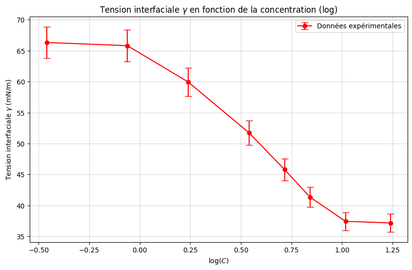
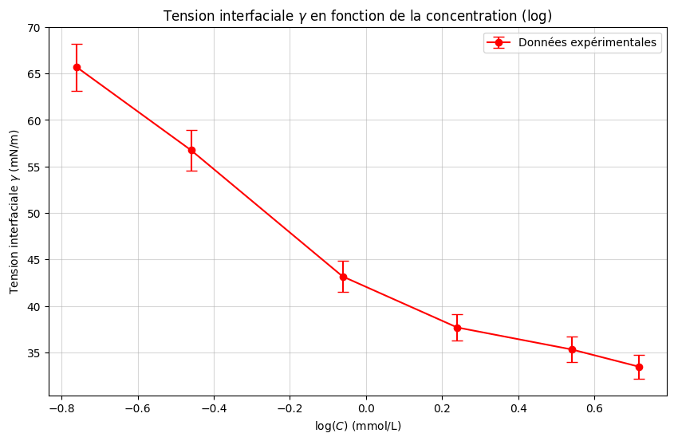
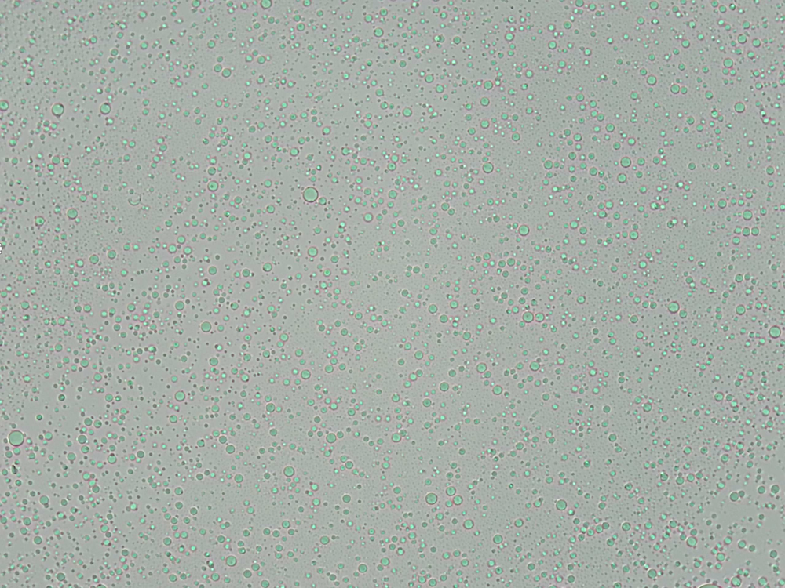

# TP Physique Statistique Appliquée — Émulsions et Interfaces

Félix Clavier & Elias Bonnefoi — ESPCI Paris PSL, 1ère année (2025-2026)

Ce TP étudie les propriétés thermodynamiques des interfaces liquides en présence de
tensioactifs (SDS), puis la stabilité et le diagramme de phase d'une émulsion directe
huile-dans-eau, en mettant en évidence les interactions colloïdales (forces de déplétion).

## Structure du dépôt

```
├── rapport.pdf              compte-rendu complet (15 pages, avec code en annexe)
├── enonce_tp.pdf             énoncé du TP
├── Python/
│   └── tension_interfaciale.py   calcul et tracé de γ(C) par la méthode de Tate
├── Images/                   graphiques de synthèse (Fig. 1 et 2 du rapport)
└── Data/                     photos au microscope (x40) de l'émulsion, à différentes teneurs en huile
```

## Partie A — Tension interfaciale et tensioactifs

La tension de surface `γ` est mesurée par la **méthode du poids de la goutte** (loi de Tate) :

```
γ = Mg / (π f a)
```

où `M` est la masse d'une goutte, `a` le rayon du capillaire, et `f` un facteur de correction
(polynôme de degré 3 en `x = a/V^(1/3)`) qui tient compte de la déformation de la goutte au
détachement.



*Tension interfaciale `γ` en fonction de la concentration en SDS (échelle log), dans l'eau.
`γ` décroît de ~66 à ~37 mN/m quand la concentration en tensioactif augmente : les molécules
de SDS s'adsorbent à l'interface eau/air et abaissent son énergie.*

**Relation de Gibbs.** Pour un tensioactif ionique 1:1 sans sel ajouté (comme le SDS, qui se
dissocie en DS⁻ + Na⁺), la relation de Gibbs `dγ = -Γ dμ` se réécrit avec un **facteur 2**
caractéristique :

```
∂γ/∂ln(C) = -2RTΓ
```

Ce facteur 2 vient du fait que les deux ions issus de la dissociation (DS⁻ et Na⁺) contribuent
chacun au potentiel chimique total du soluté ; il disparaîtrait (facteur 1) si un excès de sel
inerte (ex. NaCl) fixait la concentration en Na⁺. En supposant une adsorption de type Langmuir,
l'intégration de la relation de Gibbs donne l'**équation de Szyszkowski** :

```
γ(C) = γ_eau - 2RT·Γ∞·ln(1 + K_L·C)
```

qui permet d'extraire la concentration de saturation `Γ∞` (aire occupée par une molécule de
SDS à l'interface) à partir des points expérimentaux avant la CMC (concentration micellaire
critique). Sur ce jeu de données, `Γ∞ ≈ 6,9×10⁻⁶ mol/m²` a pu être extrait ; en revanche
l'ajustement de `K_L` n'a pas convergé sur des valeurs exploitables — un point signalé
honnêtement dans le rapport plutôt que masqué.



*Même mesure en présence de NaCl : la tension interfaciale est globalement plus basse, mais la
courbe présente plus de dispersion expérimentale que celle dans l'eau pure.*

## Partie B — Émulsions

### Fabrication et fragmentation

Une émulsion huile-dans-eau est fabriquée par cisaillement. La taille des gouttes obtenues
est contrôlée par le **nombre capillaire** `Ca = η_c·γ̇·R / γ`, qui compare les contraintes
visqueuses (qui étirent la goutte) à la tension interfaciale (qui la maintient sphérique) : au
delà de `Ca ≈ 1`, la goutte s'allonge puis se fragmente.



*Émulsion observée au microscope (grossissement x40, 30 g d'huile ajoutés) — voir aussi
`Data/x40_13g.tiff`, `x40_20g.tiff` pour les autres teneurs en huile. On observe que le
diamètre des gouttes diminue et l'émulsion devient plus monodisperse (bien que toujours
polydisperse) à mesure que la quantité d'huile augmente, cohérent avec un cisaillement plus
efficace à volume dispersé croissant.*

Un test de dilution (ajout d'eau) confirme que l'émulsion est **directe** : les gouttes
d'huile s'espacent, donc c'est bien l'huile qui constitue la phase dispersée.

### Mécanisme de floculation et diagramme de phase

En diluant l'émulsion, les gouttes floculent sous l'effet d'une **force de déplétion**
induite par les micelles de SDS en excès (pression osmotique `Π = n_m k_B T`). Un modèle de
thermodynamique statistique — gaz parfait de gouttelettes pour la phase fluide, modèle
d'Einstein pour la phase solide dense (réseau cfc) — prédit une ligne de transition
gaz/solide de la forme :

```
Φ_m = -A·ln(Φ_h) + B
```

où `Φ_m` est la fraction volumique en micelles nécessaire pour induire la floculation et
`Φ_h` la fraction volumique en huile. L'ajustement expérimental donne `A ≈ 0,019` et
`B ≈ 7,615 g/L`, mais le rapport note honnêtement que les 5 points mesurés sont trop dispersés
pour une régression fiable (un point en particulier semble aberrant) — la tendance qualitative
est confirmée, pas la valeur quantitative.

## Dépendances

```bash
pip install numpy matplotlib
```

## Exécution

```bash
python Python/tension_interfaciale.py
```
